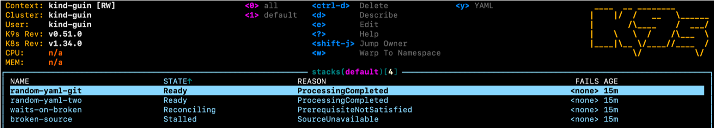
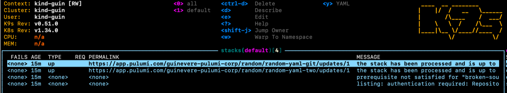

# Watching Stacks with k9s

[k9s](https://k9scli.io/) is a terminal UI for Kubernetes. It reads your cluster
with your own kubeconfig, so it needs no deployment and no extra credentials.

The dashboard works the moment you install k9s, because it reads the CRDs' printer columns.
This page shows you how to set up a better set of columns, and then a few advanced options.

## View

The Stack view will display as follows:



Press `Ctrl-W` to add the wide columns:



These stay out of the default view because of their width. Use the left and right arrow keys to scroll.

## Prerequisites

- [Install k9s](https://k9scli.io/topics/install/).
- Cluster read access to the Operator CRs. The advanced section below also needs
  permission to patch Stacks.

## View config

Write the following config to `views.yaml` in your k9s config directory:

- macOS: `~/Library/Application Support/k9s/`
- Linux: `$XDG_CONFIG_HOME/k9s/`, which defaults to `~/.config/k9s/`

Run `k9s info` if you want to confirm the path on your machine.

```yaml
views:
  pulumi.com/v1/stacks:
    sortColumn: STATE:asc
    columns:
      - 'NAMESPACE'
      - 'NAME'
      - 'STATE:.status.conditions[?(@.status=="True")].type'
      - 'REASON:.status.conditions[?(@.status=="True")].reason'
      - 'FAILS:.status.lastUpdate.failures|N'
      - 'AGE:.metadata.creationTimestamp|T'
      - 'TYPE:.status.lastUpdate.type|W'
      - 'REQ:.status.observedReconcileRequest|W'
      - 'PERMALINK:.status.lastUpdate.permalink|W'
      - 'MESSAGE:.status.conditions[?(@.status=="True")].message|W'
      - 'LAST UPDATE|H'
      - 'READY|H'
      - 'RECONCILING|H'
      - 'STALLED|H'

  auto.pulumi.com/v1alpha1/updates:
    columns:
      - 'NAMESPACE'
      - 'NAME'
      - 'TYPE:.spec.type'
      - 'STACK:.spec.stackName'
      - 'COMPLETE:.status.conditions[?(@.type=="Complete")].status'
      - 'FAILED:.status.conditions[?(@.type=="Failed")].status'
      - 'AGE:.metadata.creationTimestamp|T'
      - 'PERMALINK:.status.permalink|W'

  auto.pulumi.com/v1alpha1/workspaces:
    columns:
      - 'NAMESPACE'
      - 'NAME'
      - 'READY:.status.conditions[?(@.type=="Ready")].status'
      - 'REASON:.status.conditions[?(@.type=="Ready")].reason'
      - 'AGE:.metadata.creationTimestamp|T'
      - 'MESSAGE:.status.conditions[?(@.type=="Ready")].message|W'
```

Restart k9s after you write this file.

To customize the columns, see the k9s
[Custom Views](https://k9scli.io/topics/columns/) reference.

## Run the dashboard

```bash
k9s
```

Type `:stacks`, `:updates` or `:workspaces` to view your objects. k9s remembers
the last view per cluster, so it opens there next time.

See the [reference docs](https://k9scli.io/topics/commands/) for all k9s commands.

---

# Advanced: add additional actions

In this example, we add the following extra actions to the k9s dashboard via plugin:

1. Resync Stack - when a Stack failed for a transient reason, trigger the Operator to make another attempt
2. Open the Stack's last update in Pulumi Cloud

## Additional permissions

Write access on the cluster, for Stack resync.

## Add the keys

Write this to `plugins.yaml`, in the same directory as `views.yaml`:

```yaml
plugins:
  stack-resync:
    shortCut: Ctrl-Y
    description: Resync stack
    scopes:
      - stacks
    command: sh
    background: false
    args:
      - -c
      - |
        req="k9s-$(date +%s)"
        if kubectl annotate stack $NAME -n $NAMESPACE --context $CONTEXT --overwrite pulumi.com/reconciliation-request="$req" >/dev/null 2>&1; then
          echo "Resync requested for stack $NAMESPACE/$NAME"
          echo
          echo "  annotation  pulumi.com/reconciliation-request=$req"
          echo "  watch       the REQ column, then STATE"
          echo
          echo "The operator retries now instead of waiting out its back-off."
          echo "A resync retries. It does not repair a broken spec."
        else
          echo "Could not annotate stack $NAMESPACE/$NAME."
          echo "Check that you have patch permission on stacks in that namespace."
        fi
        echo
        printf "Press enter to close."
        read x

  stack-open-console:
    shortCut: Ctrl-O
    description: Open in Pulumi Cloud
    scopes:
      - stacks
    command: sh
    background: true
    args:
      - -c
      - 'url=$(kubectl get stack $NAME -n $NAMESPACE --context $CONTEXT -o jsonpath="{.status.lastUpdate.permalink}"); [ -z "$url" ] && exit 0; if command -v xdg-open >/dev/null; then xdg-open "$url"; else open "$url"; fi'
```

k9s loads plugins at startup only, so restart it after you write this file.

You now have key bindings for the following additional actions:

| Key | Action |
|---|---|
| `Ctrl-Y` | Request a resync of the selected Stack |
| `Ctrl-O` | Open the last update in Pulumi Cloud |

> **Caution:** if you change a shortcut, pick a key k9s does not already bind.
> One collision makes k9s reject the whole file, and the only sign is a
> `Plugins load failed` warning in `k9s.log`. The table and browser views
> reserve `Ctrl-A`, `Ctrl-C`, `Ctrl-D`, `Ctrl-E`, `Ctrl-G`, `Ctrl-R`, `Ctrl-S`,
> `Ctrl-W`, `Ctrl-Z`, `Shift-A`, `Shift-J`, `Shift-N`, `Shift-O` and `Shift-S`.


## Reference
- k9s: [Custom Views](https://k9scli.io/topics/columns/) and
  [Plugins](https://k9scli.io/topics/plugins/)
