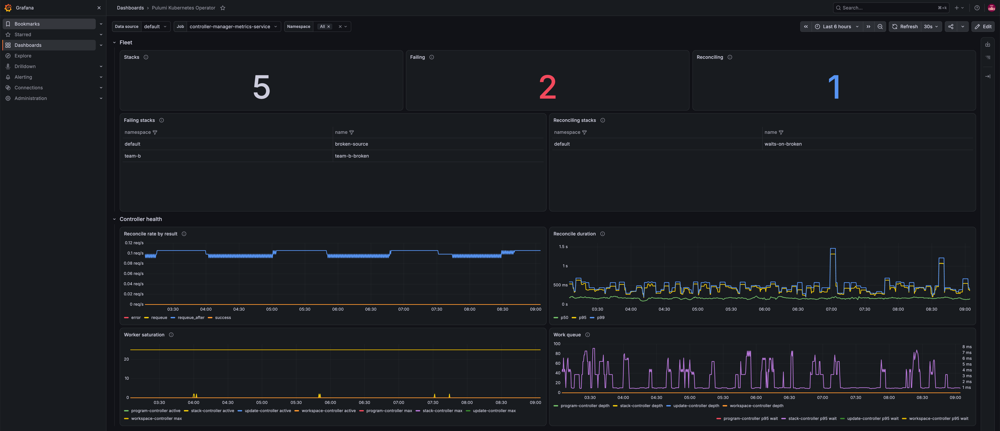

# Prometheus Metrics Integration Guide

## Introduction

The Pulumi Kubernetes Operator emits Prometheus compatible metrics.
This can be great for users to get operational insights into stacks
managed by the operator.

We provide an overview of the metrics emitted by the operator and the simplest steps necessary to emit metrics to Prometheus from the Operator.

## Prometheus Integration
If key parts of the Prometheus metrics stack are installed on the Kubernetes cluster, then as part of the initial launch
Pulumi Kubernetes Operator will automatically:
1. Create a service `pulumi-kubernetes-operator-metrics` which provides detailed operator metrics through port `8383`
2. Install a `ServiceMonitor` resource named `pulumi-kubernetes-operator-metrics` resource which is used to discover the endpoints for metric collection

Once the above are created, Prometheus will update its target scraping rules to include the Operator pod.

## Metrics Overview

The current implementation explicitly emits the following metrics:

1. `stacks_active` - a set of `gauge` time series, labelled by namespace, that reports the number of currently registered stacks managed by the system
2. `stacks_failing` - a set of `gauge` time series, labelled by namespace, that gives the number of stacks currently failing (`stack.status.lastUpdate.state` is `failed`)
3. `stacks_reconciling` - a set of `gauge` time series, labelled by namespace, that gives the number of stacks currently reconciling (`stack.status.conditions` contains a Condition of type `Reconciling` that is `True`)
4. `programs_active` - a `gauge` time series that reports the number of currently registered programs managed by the system

In addition, we find tracking the following metrics emitted by the controller-runtime would be useful to track:

1. `controller_runtime_active_workers{controller="stack-controller"}` - `gauge` that tracks the number of concurrent stacks being processed
2. `controller_runtime_max_concurrent_reconciles{controller="stack-controller"}` - `gauge` that tracks the max concurrent stack reconciles configured. This defaults to 10 but can be controlled through `MAX_CONCURRENT_RECONCILES` environment variable passed to the Operator container.
3. `controller_runtime_reconcile_total{controller="stack-controller",result="error"}` - `counter` for errored reconciles
4. `controller_runtime_reconcile_total{controller="stack-controller",result="requeue"}` - `counter` for requeued reconciles

The next section walks through setting up `Kube-Prometheus-Stack` on an existing Kubernetes cluster and configuring metrics for the operator.

## Integration with Kube-Prometheus-Stack Installed Using Helm

We assume at this point you already have a Kubernetes cluster launched and have set up `kubeconfig` to point to this cluster.
If this is not true, please [follow the steps here](https://www.pulumi.com/docs/tutorials/kubernetes/#clusters) to launch a Kubernetes cluster of your liking.

### Setup `Kube-Prometheus-Stack` metrics stack

[Kube-Prometheus-Stack](https://github.com/prometheus-community/helm-charts/tree/main/charts/kube-prometheus-stack) is an all-in-one Prometheus-based metric solution in a Helm Chart.
It packages [Kube-Prometheus](https://github.com/prometheus-operator/kube-prometheus) which consists of Prometheus Operator, Prometheus, Grafana, Alert Manager, node-exporters, etc.
Installing the `kube-prometheus-stack` Helm Chart is the simplest means to have all the components of the metrics stack installed on your cluster.

Use the following Pulumi Program to install a `Kube-Prometheus-Stack` Helm Release on your cluster

**Important** - please note the override of the `serviceMonitorSelectorNilUsesHelmValues` value. Not setting this will potentially prevent the Operator metrics services from being scraped.
```typescript
import * as pulumi from "@pulumi/pulumi";
import * as kubernetes from "@pulumi/kubernetes";

const promOperator = new kubernetes.helm.v3.Release("prom-operator", {
    name: "kube-prometheus-stack",
    chart: "kube-prometheus-stack",
    repositoryOpts: {
        repo: "https://prometheus-community.github.io/helm-charts",
    },
    values: {
        prometheus: {
            prometheusSpec: {
                serviceMonitorSelectorNilUsesHelmValues: false,
            },
        },
    },
});
```

Next install the Pulumi Kubernetes Operator. See the detailed installation instructions [here](../README.md#deploy-the-operator) for details.

Once installed, you can perform the following steps to determine if Prometheus is scraping the metrics endpoint on port `8383`:

1. Setup a port-forward against the Prometheus service: 

    `kubectl port-forward service/kube-prometheus-stack-prometheus 9090:9090`

2. Visit `http://localhost:9090/targets` and validate that `pulumi-kubernetes-operator-metrics` is known and being scraped.


### Grafana Dashboard



This repository ships a dashboard at
[`dashboards/operator-metrics.json`](../dashboards/operator-metrics.json). It
shows how many Stacks exist, which of them are failing or reconciling, and how
busy the operator's controllers are.

`kube-prometheus-stack` also installs Grafana. To import the dashboard:

1. Port forward the Grafana service:

    `kubectl port-forward -n monitoring service/kube-prometheus-stack-grafana 3000:80`

2. Read the admin password from the Secret the Helm chart created:

    `kubectl get secret -n monitoring kube-prometheus-stack-grafana -o jsonpath='{.data.admin-password}' | base64 -d`

3. In Grafana, select **Dashboards**, then **New**, then **Import**.

4. Upload `dashboards/operator-metrics.json`, or paste its contents.

5. Select your Prometheus data source, then select **Import**.

The dashboard asks for a data source on import, so it works against any
Prometheus. Two more variables at the top of the dashboard filter what you see:
**Job** selects the scrape job, and **Namespace** limits the panels to one
namespace.

#### Filter by the Stack's namespace

Prometheus adds its own `namespace` label to every metric it scrapes, which
names the namespace of the operator Pod. The operator also emits a `namespace`
label, which names the namespace of the Stack. Prometheus keeps its own label
and renames the operator's one to `exported_namespace`.

To filter by the Stack's namespace, use `exported_namespace`:

```promql
stacks_failing{exported_namespace="my-namespace"} > 0
```
